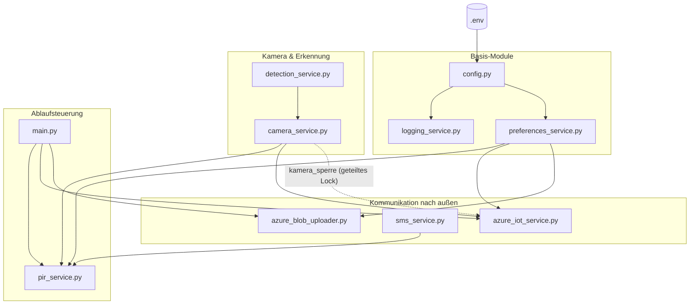
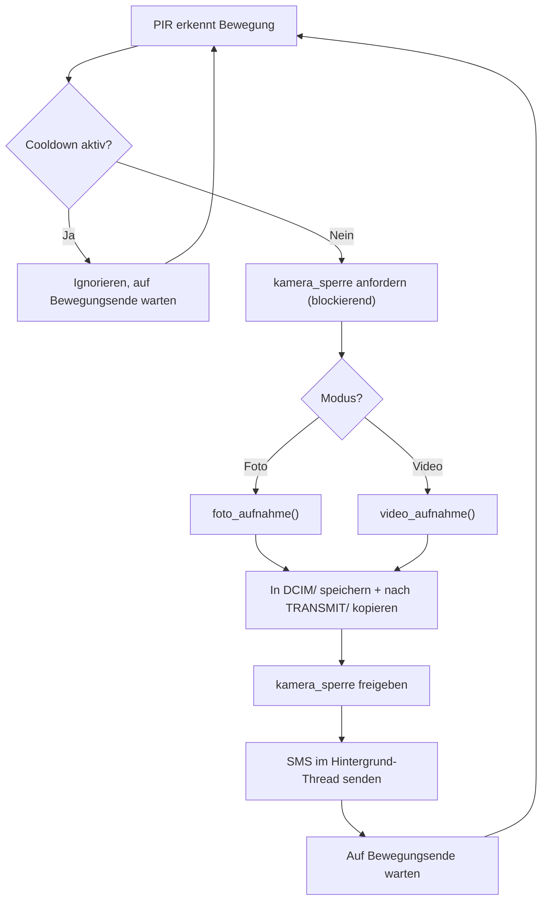
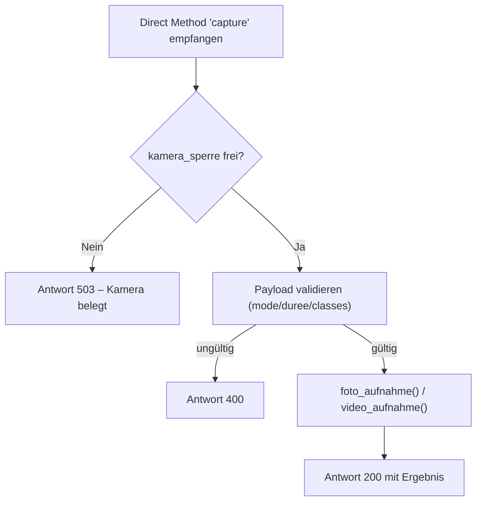
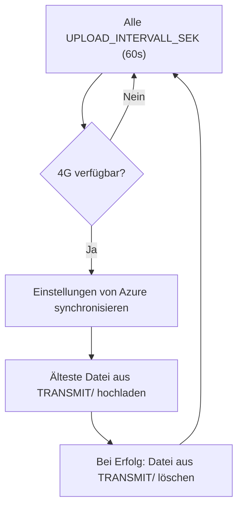
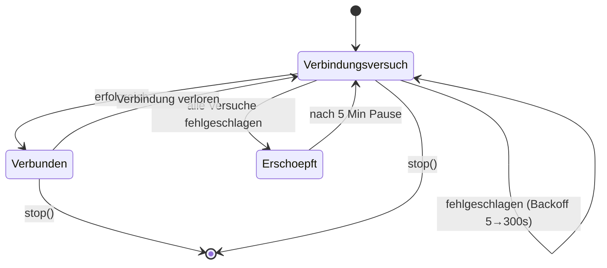

# Wildkamera Pi5 — Dokumentation

Azure IoT Hub Wildkamera-Client für den Raspberry Pi 5. Läuft ausschließlich
auf dem Pi 5 (Picamera2, libcamera, gpiozero, serieller SIM7600-Port sind
Hardware-Abhängigkeiten, die auf einem gewöhnlichen PC nicht existieren).

## Überblick

Der PIR-Bewegungsmelder löst eine Kameraaufnahme aus. Ein YOLOv26-NCNN-Modell
erkennt Wildtiere im Bild, das Ergebnis wird lokal gespeichert (DCIM/), zur
Warteschlange hinzugefügt (TRANSMIT/) und bei verfügbarer 4G-Verbindung nach
Azure Blob Storage hochgeladen. Parallel dazu lauscht der Pi auf Azure IoT
Hub Direct Methods ("capture", "set_preferences") für Fernsteuerung, und
verschickt SMS-Benachrichtigungen über ein SIM7600 4G HAT nach jeder
Aufnahme.

## Architektur (Organigramm)



Alle Module importieren zusätzlich `config.py` und `logging_service.py` für
Konstanten bzw. Protokollierung (der Übersichtlichkeit halber nicht jede
einzelne Kante eingezeichnet). Das gestrichelte Kante zeigt das einzige
Objekt, das sich zwei sonst unabhängige Module teilen: `camera_service.kamera_sperre`,
damit PIR-Aufnahmen und manuelle "capture"-Aufrufe nie gleichzeitig auf die
Kamera zugreifen.

## Module im Detail

| Datei | Verantwortung | Wichtigste Funktionen/Klassen |
|---|---|---|
| `config.py` | Zentrale Konstanten, lädt `.env` | `_env_pflicht`, `_env_optional`, alle Konstanten |
| `logging_service.py` | Ereignis-Log (Datei + Konsole) | `journal(niveau, nachricht)` |
| `preferences_service.py` | Thread-sicherer Zugriff auf Aufnahme-Einstellungen | `praeferenzen_abrufen`, `praeferenzen_aktualisieren`, `praeferenzen_von_azure_synchronisieren` |
| `detection_service.py` | YOLO-Modell laden, Boxen filtern, Bilder annotieren | `modell_laden`, `boxen_filtern`, `foto_annotieren`, `frame_annotieren` |
| `camera_service.py` | Picamera2-Steuerung, vollständige Foto-/Video-Pipelines | `kamera_sperre`, `foto_aufnahme`, `video_aufnahme` |
| `azure_blob_uploader.py` | Blob-Upload mit wiederverwendetem Client, Upload-Warteschlange | `blob_hochladen`, `upload_warteschlangen_thread`, `verbindung_verfuegbar` |
| `sms_service.py` | SMS-Versand über SIM7600 (AT-Kommandos) | `sms_senden`, `sms_im_hintergrund` |
| `pir_service.py` | PIR-Bewegungsschleife mit Cooldown | `pir_schleife` |
| `azure_iot_service.py` | Direct-Method-Handler, IoT-Hub-Wiederverbindung | `direct_method_handler_erstellen`, `IoTHubConnectionManager` |
| `main.py` | Startet und verdrahtet alle Module | `main()` |

## Ablauf: PIR-Aufnahme



## Ablauf: Direct Method "capture"



Dieselbe `kamera_sperre` wird auch vom PIR-Ablauf verwendet — daher können
PIR-Aufnahmen und manuelle Direct-Method-Aufrufe niemals gleichzeitig
laufen.

## Ablauf: Upload-Warteschlange



`blob_hochladen()` verwendet einen einmalig erstellten `BlobServiceClient`/
`ContainerClient` (Singleton in `azure_blob_uploader.py`) statt bei jedem
Aufruf einen neuen Client aufzubauen.

## Ablauf: IoT-Hub-Wiederverbindung



Gekapselt in `azure_iot_service.IoTHubConnectionManager`. Alle Wartezeiten
laufen über `threading.Event.wait(timeout=...)` statt über manuelle
`time.sleep(1)`-Schleifen — `stop()` unterbricht daher auch eine laufende
Backoff-Wartezeit sofort, statt bis zu 300s zu blockieren.

## Konfiguration

**`.env`** (niemals versionieren, siehe `.gitignore`):

| Variable | Inhalt |
|---|---|
| `IOT_HUB_CONN_STR` | Azure IoT Hub Geräte-Verbindungszeichenfolge |
| `STORAGE_CONN_STR` | Azure Blob Storage Verbindungszeichenfolge |
| `AZURE_FUNC_KEY` | Azure Function Key (leer bei `AuthLevel=Anonymous`) |
| `SMS_NUMMER` | Ziel-Rufnummer für SMS-Benachrichtigungen |
| `SMS_PIN` | SIM-Karten-PIN |

**`config.py`** enthält alle übrigen, nicht-geheimen Konstanten: Kamera-
auflösung, Video-Parameter, Konfidenzschwelle, Farben pro Tierklasse,
Verzeichnisse (DCIM/TRANSMIT/Log), GPIO-Pin, SMS-Port/-Baudrate,
Wiederverbindungs-Verzögerungen usw.

`.env.example` dient als versionierbare Vorlage mit Platzhaltern.

## Installation & Start (auf dem Pi 5)

```bash
sudo apt install -y python3-picamera2
cd pi5_wildkamera
pip install -r requirements.txt --break-system-packages
cp .env.example .env   # dann echte Werte eintragen
python3 main.py
```

Für den Dauerbetrieb: als systemd-Dienst mit `WorkingDirectory` auf diesem
Verzeichnis einrichten, damit `.env` und die relativen Importe gefunden
werden.

## Sicherheit

- Alle Geheimnisse liegen ausschließlich in `.env`, das per `.gitignore`
  ausgeschlossen ist.
- `config.py` bricht mit einer klaren Fehlermeldung ab, falls eine
  Pflichtvariable (`IOT_HUB_CONN_STR`, `STORAGE_CONN_STR`, `SMS_NUMMER`)
  fehlt.
- Empfehlung: da die ursprünglichen Schlüssel zuvor im Klartext im Code
  standen, sollten sie nach der Migration rotiert werden (IoT-Hub-SAS-Key,
  Storage-Account-Key, Function-Key).

## Bekannte Einschränkungen

- Läuft ausschließlich auf dem Raspberry Pi 5. `camera_service.py`,
  `pir_service.py` (Picamera2/libcamera/gpiozero) und `detection_service.py`
  (ultralytics) lassen sich auf einem gewöhnlichen PC nicht vollständig
  importieren — das ist beabsichtigt, es gibt bewusst keine
  PC-Kompatibilitätsschicht.
- Die JSON-Schlüssel im Austausch mit der mobilen App / Azure Function
  (`"mode"`, `"duree"`, `"classes"`, `"cooldown"`, `"saved"`, `"blob_name"`,
  `"detections"`, `"classe"`, `"confiance"`, `"bbox"`, …) sind absichtlich
  nicht übersetzt — sie sind ein API-Vertrag, kein internes Vokabular.
