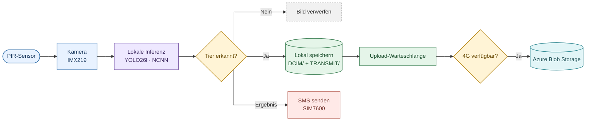
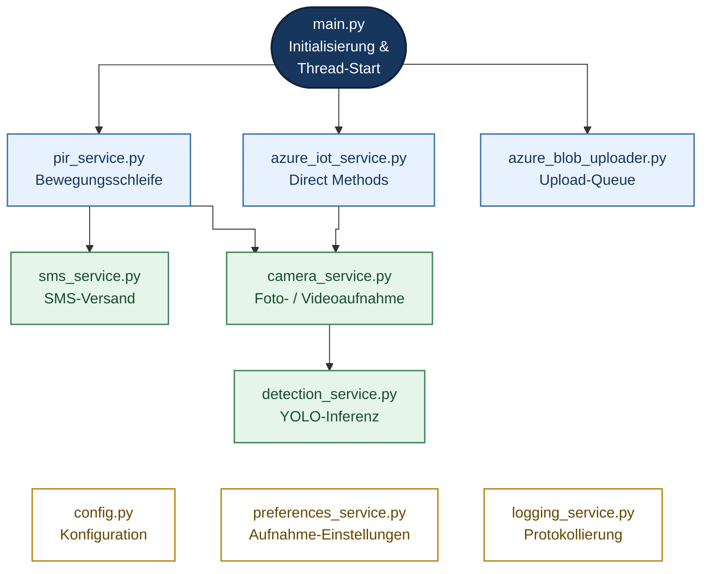
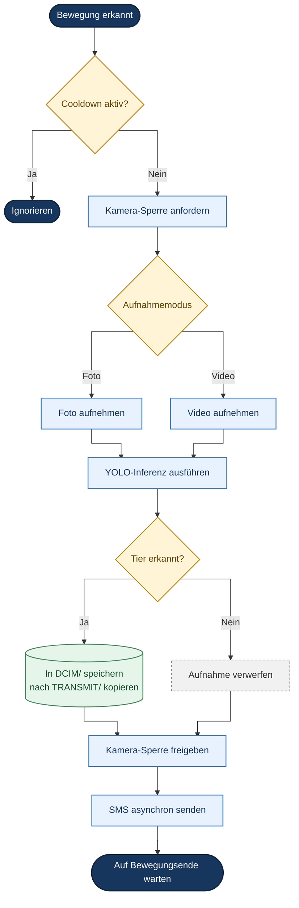
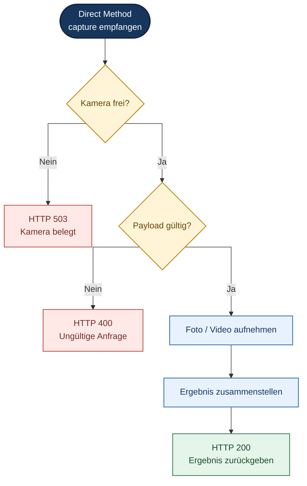
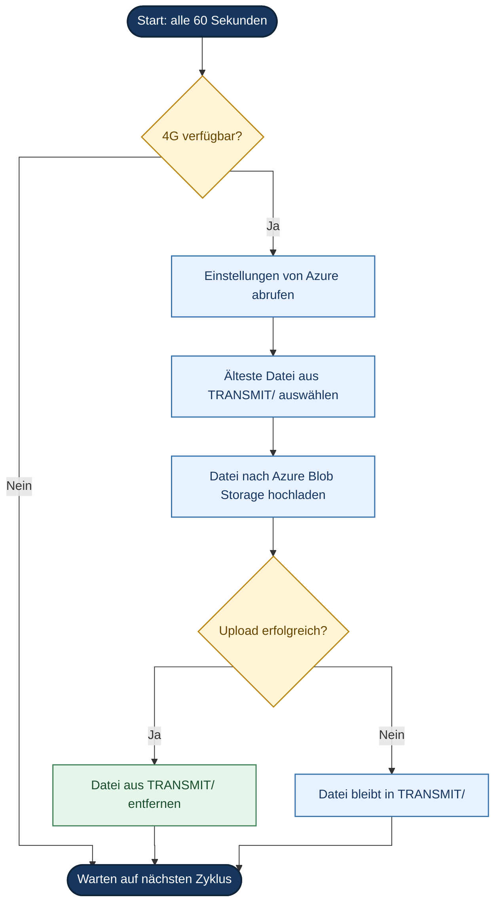
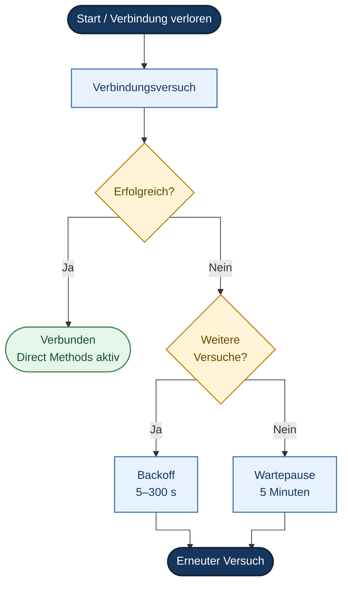

# 🦌 Wildkamera Pi 5 – Edge-KI-Wildtiererkennung

Wildkamera auf Basis eines **Raspberry Pi 5**, die Wildtiere **direkt auf dem Gerät** erkennt.
Ein feinabgestimmtes **YOLO26l-Modell** (NCNN, CPU-Inferenz) unterscheidet vier Wildarten;
nur Bilder mit Tier werden gespeichert und – sobald Netz verfügbar ist – nach **Azure** übertragen.

---

## ✨ Funktionen

- **Artbestimmung** – Hirsch, Rehbock, Rehwild und Wildschwein statt nur „Bewegung erkannt“
- **Datenschutz an der Quelle** – Bilder ohne Tier verlassen das Gerät nie
- **Offline-First** – Erkennung, Speicherung und SMS funktionieren ohne Datenverbindung
- **Fernsteuerung** – Aufnahmen und Einstellungen per Azure IoT Hub (Direct Methods)

## 📊 Ergebnisse

| Kennzahl | Wert |
|---|---|
| mAP@0.5 (4 Wildarten) | **0,875** |
| Inferenz auf der Pi-5-CPU (NCNN, 640 × 640) | ca. 600–700 ms |
| Gesamtlatenz PIR → SMS | ca. 5,3 s |
| Offline-/Reconnect-Tests | keine Verluste, keine Duplikate |

---

## 🔭 Systemüberblick



Alles links vom Upload läuft vollständig lokal auf dem Pi; die Cloud ist eine optionale Ergänzung.

## 🧩 Software-Architektur



`pir_service` und `azure_iot_service` teilen sich ein einziges Objekt: die **Kamera-Sperre**
`camera_service.kamera_sperre`. So greifen PIR-Aufnahmen und Fernaufnahmen nie gleichzeitig auf die Kamera zu.
Die Basisdienste in der unteren Reihe (Konfiguration, Einstellungen, Protokollierung) werden von allen Modulen genutzt.

### Module

| Datei | Aufgabe |
|---|---|
| `main.py` | Startet und verbindet alle Module |
| `pir_service.py` | Bewegungsschleife mit Cooldown |
| `azure_iot_service.py` | Direct Methods `capture` / `set_preferences`, Wiederverbindung |
| `azure_blob_uploader.py` | Upload-Warteschlange nach Azure Blob Storage |
| `camera_service.py` | Picamera2-Steuerung, Foto- und Video-Pipeline, Kamera-Sperre |
| `detection_service.py` | Modell laden, Erkennungen filtern, Bilder annotieren |
| `sms_service.py` | SMS-Versand über SIM7600 (AT-Kommandos) |
| `preferences_service.py` | Thread-sichere Aufnahme-Einstellungen |
| `config.py` | Zentrale Konstanten, lädt `.env` |
| `logging_service.py` | Ereignisprotokoll (Datei + Konsole) |

---

## 🔄 Abläufe im Detail

<details>
<summary><b>PIR-Aufnahme</b></summary>



</details>

<details>
<summary><b>Fernaufnahme über Direct Method <code>capture</code></b></summary>



Die Sperre wird hier **nicht blockierend** angefordert: Ist die Kamera belegt, antwortet das Gerät sofort.

</details>

<details>
<summary><b>Upload-Warteschlange</b></summary>



Der Zyklus wiederholt sich alle 60 Sekunden. Die Warteschlange liegt im Dateisystem und übersteht daher auch einen Neustart.

</details>

<details>
<summary><b>IoT-Hub-Wiederverbindung</b></summary>



„Erneuter Versuch“ startet wieder beim Verbindungsversuch, ebenso ein Verbindungsverlust. Alle Wartezeiten nutzen `threading.Event.wait()`, sodass `stop()` auch einen laufenden Backoff sofort beendet.

</details>

---

## ⚙️ Installation (auf dem Raspberry Pi 5)

```bash
sudo apt install -y python3-picamera2
git clone https://github.com/ddrickardo/pi5-wildkamera.git
cd pi5-wildkamera
pip install -r requirements.txt --break-system-packages
cp .env.example .env    # echte Werte eintragen
python3 main.py
```

Für den Dauerbetrieb als systemd-Dienst einrichten, mit `WorkingDirectory` auf dem Projektverzeichnis.

### Konfiguration

Geheimnisse stehen ausschließlich in `.env` (per `.gitignore` ausgeschlossen); `.env.example` dient als Vorlage.

| Variable | Inhalt |
|---|---|
| `IOT_HUB_CONN_STR` | Verbindungszeichenfolge des IoT-Hub-Geräts |
| `STORAGE_CONN_STR` | Verbindungszeichenfolge des Blob Storage |
| `AZURE_FUNC_KEY` | Azure Function Key (leer bei anonymem Zugriff) |
| `SMS_NUMMER` | Zielrufnummer für SMS |
| `SMS_PIN` | PIN der SIM-Karte |

Alle übrigen Einstellungen (Auflösung, Konfidenzschwelle, Verzeichnisse, GPIO-Pin, SMS-Port …) stehen in `config.py`.
Fehlt eine Pflichtvariable, bricht `config.py` mit einer klaren Fehlermeldung ab.

---

## ⚠️ Hinweise

- **Nur für den Raspberry Pi 5:** Picamera2, libcamera, gpiozero und der serielle SIM7600-Port sind Hardware-Abhängigkeiten. Eine PC-Kompatibilitätsschicht ist bewusst nicht vorgesehen.
- **API-Vertrag:** Die JSON-Schlüssel im Austausch mit App und Azure Function (`mode`, `duree`, `classes`, `saved`, `confiance`, `bbox` …) bleiben absichtlich unverändert.

## 🛠️ Technologien

Python 3 · Ultralytics YOLO26 · NCNN · OpenCV · Picamera2 · gpiozero · Azure IoT Hub · Azure Blob Storage · SIM7600 (4G/GSM)

## 📄 Lizenz

[AGPL-3.0](LICENSE)

## 👤 Autor

**Rickardo Dimbison Doré**
